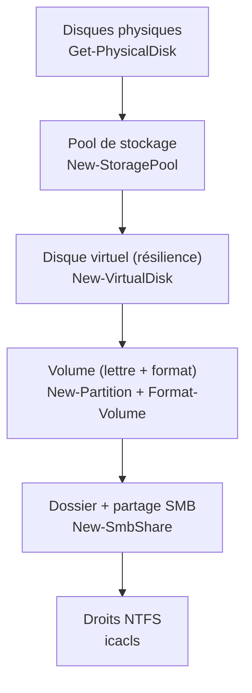

# 💾 Fiche Serveur de fichiers & Stockage — Windows Server (PowerShell)

> Commandes de référence pour gérer le stockage (pools, disques virtuels, volumes), les partages SMB et les droits NTFS.

---

## 🗺️ La chaîne du stockage (ordre à retenir)



---

## 1. Lister l'état du stockage

```powershell
Get-PhysicalDisk | Select FriendlyName, SerialNumber, MediaType, Size, CanPool, DeviceId
Get-Disk            # Les disques vus par Windows (numérotés : -Number 1)
Get-StoragePool     # Les pools de stockage existants
Get-VirtualDisk     # Les disques virtuels créés sur les pools
Get-Volume          # Les volumes avec lettres (espace libre/total)
Get-Partition | Select-Object DiskNumber, DriveLetter    # Mapping disque ↔ lettre
```

> 💡 Réflexe avant de créer un pool : vérifier quels disques sont **éligibles** :
>
> ```powershell
> Get-PhysicalDisk | Select FriendlyName, CanPool
> ```

---

## 2. Créer un pool de stockage

```powershell
Get-PhysicalDisk | Select FriendlyName, SerialNumber, MediaType, Size, CanPool, DeviceId

# Pool avec uniquement les disques 1 et 2 (par DeviceId)
New-StoragePool -FriendlyName "SRV_Compta" `
    -StorageSubSystemFriendlyName (Get-StorageSubsystem).FriendlyName `
    -PhysicalDisks (Get-PhysicalDisk | Where-Object DeviceId -in 1, 2) `
    -OtherUsageDescription "Pool pour les données du service compta"

Get-StoragePool
```

### Renommer un pool

```powershell
Set-StoragePool -FriendlyName "SRV_Compta" -NewFriendlyName "SRV_Compta_v2"
```

### Ajouter un disque à un pool existant

```powershell
Add-PhysicalDisk -StoragePoolFriendlyName "SRV_Compta" `
    -PhysicalDisks (Get-PhysicalDisk -FriendlyName "Disque 3")
```

### Détruire un pool

```powershell
# ⚠️ Détruit les disques virtuels et volumes du pool — données perdues
Remove-StoragePool -FriendlyName "SRV_Compta"
```

---

## 3. Créer un disque virtuel (avec résilience)

```powershell
New-VirtualDisk -StoragePoolFriendlyName "Pool_larbins2" `
    -FriendlyName "Pool_larbins2" `
    -UseMaximumSize `
    -ResiliencySettingName (Simple/Mirror/Parity) `
    -ProvisioningType Fixed
```

| Paramètre | Signification |
|---|---|
| `-ResiliencySettingName Simple` | **Aucune résilience** (équiv. RAID 0) — perte d'un disque = perte des données |
| `-ResiliencySettingName Mirror` | Écriture sur ≥ 2 disques (équiv. RAID 1 ; avec `-NumberOfDataCopies 3` = triple miroir) — le plus rapide en lecture/écriture |
| `-ResiliencySettingName Parity` | Équiv. **RAID 5** — tolère 1 panne, économise l'espace (écriture plus lente) |
| `-ResiliencySettingName Dual` | Équiv. **RAID 6** (double parité) — tolère **2** pannes, ≥ 4 disques |
| `-ProvisioningType Fixed` | Espace réservé **entièrement** dès la création |
| `-ProvisioningType Thin` | Espace alloué à la demande (risque de saturation silencieuse) |

> 💡 **Nombre de disques exigés** : Simple = 1 · Parity = 3 · Mirror = 2 (RAID 1) ou 4+ (RAID 10, avec `-NumberOfDataCopies 2` sur pool de 4 disques) · Dual = 4.
>
> ⚠️ Pas de RAID 5/6/7 « natifs » : ce sont des **équivalences** de Storage Spaces. Rien au-delà de Dual (pas de « RAID 7 »).

---

## 4. Créer un Volume 

### Cas A — Depuis le disque virtuel créé (chaîne complète)

```powershell
# 1. Initialiser le disque issu du disque virtuel
Get-VirtualDisk -FriendlyName "VD_Compta" | Get-Disk | Initialize-Disk -PartitionStyle GPT

# 2. Verifier les DriveLetter existante
Get-Partition | Select-Object DiskNumber, DriveLetter    # Mapping disque ↔ lettre

# 3. Créer la partition avec une lettre
Get-VirtualDisk -FriendlyName "VD_Compta" | Get-Disk | New-Partition -UseMaximumSize -DriveLetter L

# 4. Formater le volume
Format-Volume -DriveLetter L -FileSystem ReFS -NewFileSystemLabel "Compta"
```

### Cas B — Formater un disque direct (sans pool ni disque virtuel)

```powershell
Initialize-Disk -Number 1 -PartitionStyle GPT
New-Partition -DiskNumber 1 -UseMaximumSize -DriveLetter E
Format-Volume -DriveLetter E -FileSystem ReFS -NewFileSystemLabel "Compta"
```

> 💡 **ReFS vs NTFS** : ReFS = intégrité et auto-réparation (idéal données + Mirror) ; NTFS = compatibilité maximale et **obligatoire pour la déduplication**.

### Réparer un volume dégradé (ReFS / Storage Spaces)

```powershell
Repair-Volume -DriveLetter L
```

## 6. Créer un partage SMB

```powershell
# 1. Créer le dossier (JAMAIS partager la racine d'un disque !)
New-Item -Path "L:\Partage_Compta" -ItemType Directory

# 2. Partager le dossier
New-SmbShare -Name "Dossier_utilisateurs" -Path "F:\Dossier_utilisateurs" -FullAccess "Tout le monde"
```

> ⚠️ Partager `D:\` (racine) expose tout le disque, y compris `$RECYCLE.BIN` et System Volume Information. Toujours partager un **sous-dossier**.

---
### Gestion des droits du partage

Le Code suivant décrit le protocole pour uniquement utilisé les droits SMB (réseaux) et ce passer des droits NTFS (locaux + réseaux) au minimum  soit accés à tous les utilisateurs identifié.
On va donc parametre  les droits SMB  aux maximum, désativé héritage des droits NTFS et les parametre aux maximum.

```powershell
# Lister tous les partages du serveur
Get-SmbShare

# Voir qui a quels droits sur un partage
Get-SmbShareAccess -Name "Dossier Utilisateurs"

# Donner un droit
Grant-SmbShareAccess -Name "Dossier Utilisateurs" -AccountName "Tout le monde" -AccessRight Full -Force

# Visualisation des droits NTFS
icacls "F:\Dossier_utilisateurs"

# Suprimé héritage des droits NTFS
icacls "F:\Dossier_utilisateurs" /inheritance:d

# Suprimé les Utilisateurs créer automatiquement avec le dossier
 icacls "F:\Dossier_utilisateurs" /remove "BUILTIN\Utilisateurs"

# Crée un objet touts les utilisateurs authentifier on accés aux dossier
 icacls "F:\Dossier_utilisateurs" /grant "*S-1-5-11:(OI)(CI)M"

# Retirer l'ACE actuelle (celle avec (F))
icacls "F:\Dossier_utilisateurs" /remove "CREATEUR PROPRIETAIRE"

# Recréer la même ACE mais avec Modify au lieu de Full
icacls "F:\Dossier_utilisateurs" /grant "CREATEUR PROPRIETAIRE:(OI)(CI)(IO)M"

# Vérifier
icacls "F:\Dossier_utilisateurs"
 
```

| Paramètre | Niveau SMB | Ce que ça donne |
|---|---|---|
| `-FullAccess` | Contrôle total | Gérer le partage lui-même + tout faire dedans |
| `-ChangeAccess` | Modification | Lire, écrire, supprimer — mais pas gérer le partage |
| `-ReadAccess` | Lecture | Lire uniquement |
| `-NoAccess` | **Refus total** | Aucun accès, même pas en lecture |

## 7. Droits icacls

### Commandes de base

```powershell
icacls "L:\Partage_Compta"                                    # Lister les droits
icacls "L:\Partage_Compta" /grant "LOUPULUS\DLG_RW_Compta:(OI)(CI)M"   # Donner des droits
icacls "L:\Partage_Compta" /remove "BUILTIN\Utilisateurs" "Tout le monde"  # Retirer des droits
```

### Gérer l'héritage

```powershell
icacls "L:\Partage_Compta" /inheritance:r   # Retire TOUS les droits hérités (reste : les droits explicites, souvent aucun)
icacls "L:\Partage_Compta" /inheritance:d   # Détache : les droits hérités sont COPIÉS en droits explicites
```

> 💡 Procédure classique sur un nouveau partage :
> 1. `/inheritance:r` ou `/remove` des groupes génériques hérités (`Utilisateurs`, `Tout le monde`)
> 2. `/grant` des droits ciblés aux groupes DLG avec `(OI)(CI)`

### Droits simples (à connaître par cœur)

| Acronyme | Nom français | Ce que l'utilisateur peut faire |
|---|---|---|
| **F** (FC) | Contrôle total | Tout : lire, écrire, supprimer, **modifier les permissions**, **prendre possession** |
| **M** | Modification | Lire, écrire, créer, renommer, **supprimer** — mais **pas** changer les permissions |
| **RX** | Lecture et exécution | Parcourir, ouvrir les fichiers, lancer les programmes (.exe) |
| **R** | Lecture | Parcourir et lire, **aucune** écriture |
| **W** | Écriture | Créer/écrire des fichiers — mais **ne peut même pas les relire** (très rare, presque jamais utilisé seul) |
| **D** | Suppression | Supprimer le dossier/fichier, rien d'autre |

### Flags d'héritage

| Flag | Signification | Explication |
|---|---|---|
| **(OI)** | Object Inherit | Les **fichiers** contenus héritent du droit |
| **(CI)** | Container Inherit | Les **sous-dossiers** héritent du droit |
| **(IO)** | Inherit Only | Le droit s'applique uniquement aux **enfants**, pas au dossier lui-même |
| **(NP)** | No Propagate | Le droit s'arrête au premier niveau (les petits-enfants n'héritent pas) |
| **(I)** | Inherited | S'affiche à la consultation : le droit vient du dossier parent |

### Droits élémentaires (affichés dans les détails)

| Acronyme | Droit élémentaire |
|---|---|
| **DE** | Supprimer (DElete) |
| **RC** | Lire les permissions (Read Control) |
| **WDAC** | Modifier les permissions (Write DAC) |
| **WO** | Prendre possession (Write Owner) |
| **S** | Synchroniser (Synchronize) — technique, toujours présent |
| **GR / GW / GE / GA** | Lecture / Écriture / Exécution / Tout en « générique » |


## 9. 🧠 Mémo pièges d'examen

1. La chaîne : **disques physiques → pool → disque virtuel → volume → dossier → partage → droits NTFS**
2. **Droits effectifs = le plus restrictif** entre SMB et NTFS
3. Un **refus explicite NTFS prime sur tout le reste** (même un Full ailleurs)
4. **Simple** = RAID 0 ; **Mirror** = RAID 1/10 ; **Parity** = RAID 5 ; **Dual** = RAID 6 ; pas de « RAID 7 » dans Storage Spaces
5. **Déduplication = NTFS uniquement** (jamais sur ReFS)
6. `New-SmbShare` crée le droit de **partage** ; `icacls` les droits **NTFS** — il faut configurer **les deux**
7. Ne jamais partager la **racine d'un disque**
8. `/inheritance:r` **supprime** les hérités ; `/inheritance:d` les **copie** en explicites
9. `Get-PhysicalDisk -CanPool $true` = réflexe avant de créer un pool
10. **AGDLP** : les utilisateurs vont dans les groupes globaux, qui vont dans les groupes de domaine local, qui portent les droits (c'est aux **DLG** qu'on accorde l'accès aux ressources, pas directement aux utilisateurs)